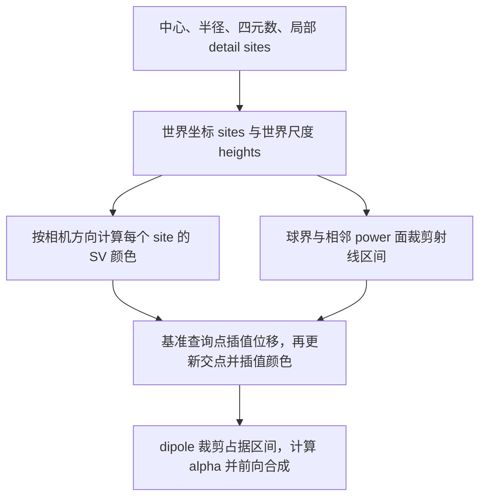

# Power Foam：论文与本仓库代码对照阅读

阅读日期：2026-09-24；整理核对：2026-09-25。论文为官方项目页提供的完整 PDF，23 页，包含补充材料。
本记录对应仓库 HEAD `2e5cd54269c77a5d08797078b0c4d5b7969f357c` 下的本地代码；
文件校验值和阅读覆盖范围见 [来源记录](references/powerfoam/README.md) 与
[manifest.json](references/powerfoam/manifest.json)。

这次工作是阅读、推导核对和调用链检查，没有重新训练论文场景，也没有完成梯度数值审计。
下文区分代码明确实现的行为、论文表述、以及仍需验证的问题。

## 1. 首先纠正之前讨论的对象

Power Foam 的表达不能简化成“一个球形 cell 带一个颜色”。至少要分清三层：

1. **空间分区**：中心和半径生成 bounded power cell，决定这个 primitive 可以占据的空间。
2. **内部表面**：cell 内有独立朝向的 dipole 基准面，局部控制点再提供沿法向的位移。
3. **外观**：这些局部控制点各自带视角相关的颜色函数，经过空间插值得到射线使用的颜色。

因此，“相邻 cell 的裁剪面只能通过位置和半径生成”是对第一层的正确描述，
但不能由此推出内部表面的转向也只能靠这些参数。
之前讨论形变时没有充分区分这三层，并把简化原型的结果外推到完整方法，这是需要撤回的判断。

## 2. 实际存储的参数

参数定义见 [scene.py](powerfoam/scene.py)，初始化在第 82–191 行。
令 cell 数为 N，detail site 数为 K，每个 site 的 Spherical Voronoi 方向数为 D；默认 K=D=8。

| 参数 | 存储形状 | 代码中的作用 |
| --- | --- | --- |
| `points` | N × 3 | cell 中心，同时是 dipole 基准面的原点 |
| `radii` | N | 原始优化变量；`get_radii()` 用 beta=100 的 softplus 得到正半径 |
| `quaternions` | N × 4 | 归一化后生成法向及两个切向，独立于相邻中心连线 |
| `density` | N | 经 softplus 得到非负光学消光系数，不是自动满足质量守恒的物质密度 |
| `texel_sites` | N × K × 2 | 基准面局部坐标，转世界坐标时乘当前半径 |
| `texel_height` | N × K | 局部位移值，转世界尺度时同样乘当前半径 |
| `texel_sv_axis` | N × K × (3D) | 每组原始三维向量的方向作为 SV 轴，长度作为温度 |
| `texel_sv_rgb` | N × K × (3D) | 每个 SV 轴的三通道颜色参数 |

注意代码使用四元数旋转矩阵的第一行构造法向，另外两行构造切向，不能想当然按“局部 z 轴是法向”接变形。
对应 `get_normals()` 第 242 行、`get_tangents()` 第 259 行、`get_att_sv()` 第 290 行。

## 3. cell 边界与内部表面是两回事

### 3.1 中心和半径生成的空间分区

定义

```text
q_i(x) = ||x - p_i||² - r_i²
C_i = { x : q_i(x) <= 0 且 q_i(x) <= q_j(x), 对所有 j }
```

球界与半空间共同裁剪出凸 cell。相邻 power 等值面为

```text
2 x · (p_j - p_i) = ||p_j||² - ||p_i||² + r_i² - r_j²
```

固定中心时，半径改变这个面的偏移，不改变其法向。
这是直接展开二次式得到的结论，对应 [rendering_math.py](powerfoam/rendering_math.py) 第 63 行。
cell 只在球并集内存在，球外不自动填充实体；球体积也不等于裁剪后的 cell 体积。

### 3.2 dipole 面和局部细节

cell 内的基准面是 `n_i · (x-p_i)=0`，其法向由自己的四元数决定。
位移后查询所用平面是 `n_i · (x-p_i)=h`。
渲染器把有密度的一侧与 cell 内射线区间相交，而不是给 cell 的所有外边界都贴一层不透明颜色。

论文 §3.4、图 7、式 (3)(4) 对应的实现主要在
[texture.py](powerfoam/texture.py) 第 11 行和
[rasterize.py](powerfoam/rasterize.py) 第 68、893 行。
位移与颜色共享 detail sites，但有各自的数值参数。

## 4. 从局部控制点到一条射线的颜色

实际入口是 [scene.py](powerfoam/scene.py) 第 314 行 `PowerfoamScene.forward()`：



### 4.1 局部坐标随半径和坐标系一起生成世界位置

设两个切向为 a、b，局部 site 为 `(u_k,v_k)`，存储的局部高度为 d_k：

```text
s_k_world = p + r (u_k a + v_k b)
h_k_world = r d_k
```

这意味着改变半径同时改变球界、power 权重、detail site 的空间分布和高度尺度。
只修改送入底层 renderer 的球半径，而继续使用旧 world sites，并不等价于调用原模型的 forward。

### 4.2 先计算视角相关颜色

[color_fn.py](powerfoam/color_fn.py) 第 55–101 行对每个 site 计算：

```text
direction_k = normalize(s_k_world - camera_origin)
w_kl = exp(-temperature_kl * ||direction_k - axis_kl||)
c_k = max( sum_l(w_kl * rgb_kl) / sum_l(w_kl) + 0.5, 0 )
```

最后的 max 按通道作用，没有上限 1 的截断。
方向取相机到 site 的方向，在每个相机下预先生成 K 个颜色，不是每条像素射线单独求一次 SV。
这是**方向域的插值**；下面还有一次**空间域的插值**，两者不能混为一谈。

`scene.forward()` 传给 SV 的 world sites 显式 `.detach()`。
SV 对方向轴、温度和颜色有梯度，但没有“方向随 site 位置变化”这条几何梯度。
这不意味着 detail site 的全部几何梯度被停止：它们在后续空间插值中的路径仍保留。

### 4.3 插值位移，再插值颜色

`texture.plane_intersection_fwd()` 的实际顺序：

1. 求射线与基准面的交点参数 `t_base`，同时得到 `dp=n·ray_direction`。
2. 取初始查询参数：`dp>=0` 时用 cell 进入点 `t_near`；否则用 `max(t_near,t_base)`。
3. 在初始查询点 x0 用空间权重插值得到高度 h。
4. 把基准面沿法向偏移 h，重新算 `t_surface`。
5. 用同样的分支规则得到新的查询点 x1，在 x1 插值 RGB。

代码中的空间权重为

```text
w_k(x) = exp(-10 * ||x - s_k_world||² / r²)
h(x0) = sum_k w_k(x0) h_k_world / sum_k w_k(x0)
c(x1) = sum_k w_k(x1) c_k       / sum_k w_k(x1)
```

权重使用世界空间三维距离，分母下限是 1e-20。
这是“一次位移估计 + 更新交点 + 颜色查询”，不是迭代求解任意连续高度场的精确交点。
因此把它解释成一般 mesh、任意 implicit surface 或完整形变体也不准确。

### 4.4 区间积分与合成

经过球界、power 面和 dipole 裁剪得到有密度的射线区间长度 Δt：

```text
alpha_i = 1 - exp(-sigma_i * Δt_i)
RGB = sum_i T_i * alpha_i * c_i
T_i = product_{j before i}(1-alpha_j)
```

世界射线方向归一化，Δt 是世界长度；区间内使用一次查询得到的颜色。
代码的 depth 是透射率分位点对应的射线距离，不能直接当成相机 z 深度。

## 5. 两条渲染路径依赖不同的邻接结构

### 5.1 训练光栅化

调用链：`train.py` → `scene.forward()` → `RasterGradFn` → `Rasterizer._forward()` → Warp kernel。

- [bvh.py](powerfoam/bvh.py) 用球 AABB 做 broad phase，再以 `distance < r_i+r_j` 建立球相交的 Čech 图。
- 对 bounded cell，保守加入多余的相交球裁剪约束可以得到同样的精确空间分区，不需要每次先算完整 regular triangulation。
- [rasterize.py](powerfoam/rasterize.py) 将投影分配到 8×8 tiles，排序依据是相机位置的 power distance `||p_i-eye||²-r_i²`，不是普通 z 深度。
- 论文补充 B 的排序依据针对同源射线与 power partition；不能把它无条件延伸到不同 metric 的二次 cell。
- “pop-free”涉及静态表示的可见性排序，不等于任意时间变化参数下外观必然连续。

`train.py:189–194` 的邻接重建间隔从 1 逐渐增到 20；原训练循环并非每次参数更新都重建图。
动态扩展若快速移动 primitive，不能直接假设沿用这个更新频率仍有完整邻接。

### 5.2 benchmark 光追

[benchmark.py](benchmark.py) 第 25 行把点提升到
`(x,y,z,||p||²-r²)`，由四维凸包下包络恢复 regular triangulation。
**这里的第四维是计算几何 lifting，不是时间，不是现成的 4D 动态 Power Foam。**

[raytrace.py](powerfoam/raytrace.py) 从相机所属的 power cell 开始，沿相邻 power 面穿行。
即使当前 cell 没有球内有密度区间，也要继续穿越空域。因此需要对应无界 power diagram 的完整邻接，
不能简单换成只含球重叠关系的 Čech 图。Steiner cells 用于改善空域穿行效率。

本仓库 `RayTracer` 只实现构造和 `benchmark()`，没有训练 `forward/backward`，也没有 `visualize()`。
`scene.forward_visualization(render_mode="raytrace")` 最终却会调用 renderer 的 `visualize()`；
这条接口静态检查不闭合，不能据此声称已经有可直接使用的训练或交互光追管线。

## 6. 训练到底优化什么

[train.py](train.py) 第 238–295 行将以下项加权求和：

| 项 | 当前实现 | 不应误解成 |
| --- | --- | --- |
| RGB | 像素 RGB 的平方误差 | cell 所有权标签监督 |
| SSIM | `1-ssim(rgb,rgb_gt)` | 时间一致性监督 |
| Normal | 渲染累计 `T alpha max(n·d,0)²`；另有可选额外法向监督 | 对 MPM 应力或材料法向的约束 |
| Contribution | 每个 primitive 可见贡献之和 | 严格的 cell 数量约束 |
| Interpenetration | 邻接球的 `max(r_i+r_j-distance,0)²` | 无孔洞、体积或质量守恒约束 |

配置及参数组在 [configs](configs) 和 `scene.declare_optimizers()`；位置、半径、朝向、密度、
局部坐标、位移与 SV 外观各有优化参数组。位移学习率有 warmup，并非从头到尾固定为零。

`scene.update_stats()` 和 `resample()`（第 601、618 行）依据贡献和误差的滑动统计进行裁剪与复制：
低贡献 cell 被删，保留 cell 中按误差抽样复制，复制局部外观、几何参数和 Adam 状态，
再在切平面内施加位置扰动。这不是给新 cell 随机指定一个无关的红色或蓝色。

`sort_points()` 也会重排所有参数和优化器状态。因此数组下标天然不是永久材料粒子 ID。
数据入口 `DataHandler` 提供静态相机、图像、alpha、可选法向；原始模型没有时间、速度、F 或物质质量状态。
“一个 cell 对应一个 MPM 粒子”是我们新增的建模假设，不是原论文保证的语义。

## 7. 论文和代码的差别，以及需要另行验证的实现问题

这些记录用于明确当前读到什么，不能代替数值复现，也不能拿来替之前简化实验的越界结论辩护。

### 已确认的表达或实现差异

| 位置 | 论文/接口与当前代码的差别 |
| --- | --- |
| 主文 p.10，式 (3)(4)；`texture.py:35,58` | PDF 印刷公式使用未平方的二范数；代码使用平方距离、除以 r²、固定温度 10。已看 PDF 页面确认，不仅依赖文本提取。 |
| 补充 B，式 (9)(11)(14)；`rendering_math.py:63` | PDF 中 (11)(14) 的权重差符号与 (9) 的定义展开不一致，疑似排印错误。按 `pow=距离平方-权重` 应为右侧 `+ω_P-ω_P'`，与本记录第 3 节及代码一致。半空间结构本身不受这个符号笔误影响。 |
| 补充 C；`benchmark.py:137` | 论文 Steiner 算法 6 轮、按 power 最近邻；代码 10 轮，在欧氏 32 近邻中最小化 `distance-radius`，采样标准差乘 0.5，并有候选重叠筛选和半径乘 0.8。两者不能称为逐行一致的算法。 |
| `rasterize.py:581` | 训练/可视化邻接缓存的中心差和邻居半径使用 float16，即使主参数是 float32。benchmark 的邻接缓冲字段语义又不同，不能混用。 |
| `rasterize.py:141,294` | pinhole 投影路径剔除相机距中心小于 4r 的球。底层数学允许的射线不等于这个 API 全部支持的输入。 |
| `rasterize.py:1231` | surface objective 的反向分支抛出 `NotImplementedError`；当前配置使用 volume。 |

### 静态阅读发现，尚未做数值影响验证

- **训练 SSIM 的布局**：`train.py:244` 将 H×W×3 的 RGB 直接传给 `metrics.ssim()`；
  `metrics.py:113` 取 `size(-3)` 当通道数并使用 `conv2d`。按此调用形状，H 会成为通道轴，
  卷积空间轴成为 W×3。评估包装会转换布局，训练这一处没有相同转换。需单独复现并修复后比较。
- **normal loss 手写反向**：`rasterize.py:1114` 前向使用 `(n·d)²`；
  第 1383、1393 行的 alpha/trans 梯度使用一次幂，第 1424 行法向直接项也没有相应 `2(n·d)`。
  从代数上看不匹配，尚未用有限差分隔离验证其训练影响。
- **纹理权重对半径的显式导数**：`texture.plane_intersection_bwd()` 不返回来自权重分母 r² 的半径梯度。
  半径仍通过球/裁剪面、world sites 和 world heights 等路径收到梯度；不能说“半径没有梯度”。
- **generic camera 可视化**：训练 forward/backward 有 generic 分支，但 `Rasterizer.visualize()`
  的 kernel 调用参数沿用 pinhole 路径；需要另行检查相应接口，不应仅凭存在 generic kernel 宣称全链路可用。

本次只记录，没有修改这些核心实现，也没有把疑点当成已测得的质量或性能结论。

## 8. 对前面实验结论的修正

| 已有工作 | 实际检验的东西 | 不能推出的结论 |
| --- | --- | --- |
| `affine_probe` / `fit_affine_cells` | 人工指定的材料 cell 标签，在固定外观和受限中心/半径条件下能否被搬运或拟合 | 完整 Power Foam 经图像训练后不能表示相应形变；一个 cell 必须等于一个材料粒子 |
| shared-F / varying-F renderer | 我们定义的距离函数、区间裁剪与解析形变参考之间的一致性；冻结外观，零位移 | 已完成原论文复现；已验证真实动态场景、MPM 或完整视角相关纹理 |
| `spacetime_probe` | 自定义时空二次竞争在固定时间上的 3D 切片等价性，以及受控渲染结果 | 已训练出 4D Power Foam；已经证明该方向优于或劣于 4DGS |
| 红蓝 handoff | 给两 cell 人为设置不一致颜色，所有权切换时可以构造跳变 | 真实训练后的 4D Power Foam 必然闪烁；必须先改表示才能解决 |

更具体地，`experiments/spacetime_probe.py:20` 把 site 偏移按峰值/参考半径固定，
而切片半径随时间变化；这没有复现 `scene.forward()` 用当前半径和局部坐标生成 world sites 的完整机制。
它还固定 +z 法向、零高度、cell 内常色，绕过 SV、局部参数优化与原始 densification。
“使用原仓库底层 rasterizer”只能说明调用了那个渲染部件，不能说明验证了完整原模型。

之前基于这些实验对动态表示能力和研究优先级作出的强结论应撤回。
有效的几何恒等式与数值诊断可以保留，但必须和对完整方法的结论分开。

## 9. 后续讨论的依据

目前能确定的是：需要一起考虑空间分区、内部位移表面、局部外观坐标及视角相关颜色，
不能只让中心和半径动起来后就把结果当成 Power Foam 动态化的最终能力。
反过来，原方法有局部细节也不自动证明任意动态扩展会成功。

在重新评价 MPM 或 4D 方案前，应以原始 `PowerfoamScene.forward()` 的完整链路为依据，
说明哪些参数随时间改变、如何生成 detail sites/heights、保留哪些梯度、如何处理邻接和增删。
若再做实验，要把“公式/内核正确性”“静态基线复现”“真实时序拟合或材料输运”分别报告。
本文没有据此宣布一个新的动态方案已经成立。
